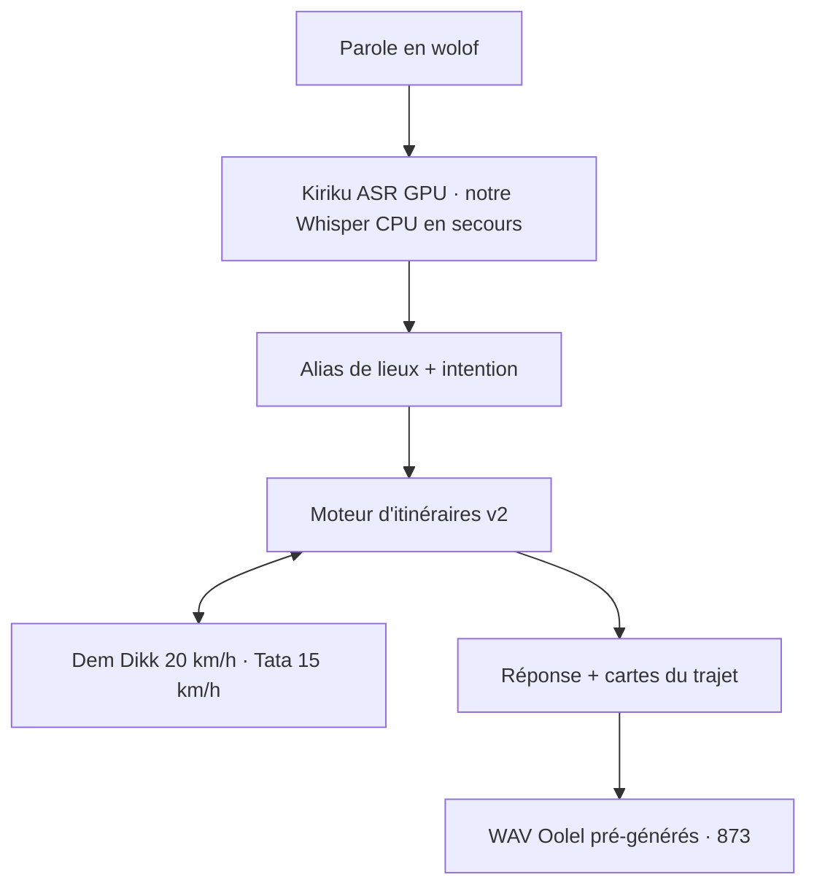

# 🚌 GuindiMa AI

### Assistant vocal en wolof qui dit aux usagers de Dakar quel bus prendre

[](https://www.python.org/)
[](https://www.gradio.app/)
[](https://huggingface.co/spaces/PythonMindset/guindima-ai)
[](#-comment-lapp-utilise-les-modèles)
[](#-comment-lapp-utilise-les-modèles)
[](LICENSE)

## 📑 Sommaire

- [📋 Contexte et problème](#-contexte-et-problème)
- [🎯 Solution](#-solution)
- [📸 Aperçu](#-aperçu)
- [🧠 Comment l'app utilise les modèles](#-comment-lapp-utilise-les-modèles)
- [🧭 Architecture](#-architecture)
- [🗣️ Le wolof, par un locuteur natif](#️-le-wolof-par-un-locuteur-natif)
- [📊 Résultats clés](#-résultats-clés)
- [🔎 Fiabilité](#-fiabilité)
- [🕰️ Chronologie](#️-chronologie)
- [⚠️ Limites](#️-limites)
- [🚀 Lancer l'app vous-même](#-lancer-lapp-vous-même)
- [🔮 Prochaines étapes](#-prochaines-étapes)
- [👨‍💻 Auteur](#-auteur)
- [💚 Crédits et licences](#-crédits-et-licences)
- [📄 Licence](#-licence)
- [🙏 Remerciements](#-remerciements)
- [🌍 In English](#-in-english)

---

## 📋 CONTEXTE ET PROBLÈME

GuindiMa dit aux habitants de Dakar quel bus prendre, à la voix, en wolof. Il a
été construit pour le **hackathon GOMYCODE x NVIDIA** (27 septembre 2026), où il
a gagné la **2e place du Sénégal** et le **NVIDIA Brev Breakthrough Award**.

Beaucoup d'usagers des bus de Dakar parlent wolof et ne lisent pas, ou lisent
peu. L'information dont ils ont besoin est dispersée, et pas toujours écrite
dans la langue qu'ils utilisent. Les minibus Tata AFTU et les bus Dakar Dem Dikk
desservent des lignes qui se croisent, et l'usager doit souvent demander son
chemin à l'arrêt.

---

## 🎯 SOLUTION

Dis, ou écris, en wolof d'où tu pars et où tu vas. GuindiMa répond à voix haute
et à l'écran : la compagnie (Dakar Dem Dikk ou Tata AFTU), la ligne, où monter,
où descendre, la direction, les changements possibles et la marche à pied.
L'écran reprend le trajet en cartes simples, en français. L'app est pensée pour
être utilisable entièrement à la voix, par des personnes qui lisent peu.

**Liens :**

- 🌐 **Démo en ligne :** **https://huggingface.co/spaces/PythonMindset/guindima-ai**
- 💻 **Code :** **https://github.com/chniang/wolof-bus-assistant**

Le moteur d'itinéraires v2 et la voix native Oolel (873 réponses pré-générées)
sont en ligne.

---

## 📸 APERÇU

<!-- TODO: add two screenshots — the Wolof voice answer and the trip cards -->

---

## 🧠 COMMENT L'APP UTILISE LES MODÈLES

| Partie | Modèle | Ce qu'il fait |
| --- | --- | --- |
| Parole vers texte, GPU | `AIHubSN/Kiriku-Wolof-ASR` | Transcrit l'enregistrement en wolof ; reconnaît bien mieux les noms d'arrêts qu'un Whisper générique. |
| Parole vers texte, CPU | `PythonMindset/whisper-small-wolof-dakar-essai3` | Notre Whisper, affiné sur des voix wolof collectées à Dakar (int8, CPU). Il prend le relais quand le GPU gratuit n'est pas accordé. |
| Parole vers texte, secours | `M9and2M/whisper-small-wolof` | Repli public si notre dépôt privé affiné n'est pas disponible. |

Les autres parties ne font pas d'ASR :

| Partie | Modèle ou code | Pourquoi |
| --- | --- | --- |
| Moteur d'itinéraires | Notre code Python : graphe de (ligne, sens, arrêt), Dijkstra/A\*, deux changements au plus, changements à pied | Trouve les bus, les changements et la marche à partir des données publiques des lignes. |
| Réponse parlée | Oolel-Voices de `soynade-research` (AGPL-3.0), voix native `8_1_c` | Fichiers WAV pré-générés ; aucun modèle TTS ne tourne dans l'app. |
| Extraction des lieux, dernier recours | `meta/llama-3.2-11b-vision-instruct` sur NVIDIA Build | Appelé seulement quand l'extraction locale, par dictionnaire, ne trouve aucun trajet complet. |
| Petite conversation | Règles simples, en wolof | Salutations, remerciements, « qui es-tu », « quel est ton métier », « comprends-tu le wolof ». |

---

## 🧭 ARCHITECTURE



- **Parole vers texte :** Kiriku-Wolof-ASR sur GPU au démarrage ; notre
  `whisper-small-wolof-dakar-essai3` (affiné à Dakar, int8, CPU) prend le relais
  et sert aussi la seconde chance de transcription ; `M9and2M/whisper-small-wolof`
  en secours.
- **Compréhension :** alias de lieux et nombres wolof d'abord, en local ;
  Llama 3.2 sur NVIDIA Build seulement si l'extraction ne trouve aucun trajet
  complet.
- **Moteur d'itinéraires v2 (par défaut) :** le graphe de (ligne, sens, arrêt)
  est construit une fois au démarrage ; recherche Dijkstra/A\* ; changements à
  pied ; Dem Dikk à 20 km/h, Tata à 15 km/h ; le trajet direct le plus rapide
  passe en premier. `GUINDIMA_MOTEUR=v1` ramène l'ancien moteur, exprès.
- **Réponse :** 873 WAV pré-générés avec la voix native Oolel `8_1_c` ; le
  lexique de prononciation est écrit par un locuteur natif (biis, Tattaa,
  Gaar…).

---

## 🗣️ LE WOLOF, PAR UN LOCUTEUR NATIF

Les réponses en wolof ont été vérifiées par des locuteurs natifs, et le lexique
de prononciation est écrit par un locuteur natif du wolof. L'app utilise des
phrases relues plutôt que du texte libre : la réponse orale reste courte et
prévisible.

L'orthographe parlée est séparée du nom affiché. Par exemple, `TAF TAF OUAKAM
(TO1)` se dit `TAF TAF Wakaam`, et les numéros de ligne se disent en mots wolof
(« numero benn »), jamais en chiffres français. Le lexique
(`src/tts/lexique_prononciation.py`) fait dire « biis » pour « bus », « Gaar »
pour « Gare » et « Tattaa » pour « Tata ». Un mot corrigé une fois est corrigé
dans toutes les réponses.

Quand deux possibilités existent, l'app dit les deux, séparées par « Walla, »,
et affiche les deux options à l'écran.

---

## 📊 RÉSULTATS CLÉS

D'après l'audit sur disque de **304 paires de trajets** :

- ✅ **0 réponse absurde.**
- ✅ **71 %** des paires trouvent une ligne directe.
- ✅ durée moyenne du trajet : **54,4 min**.
- ✅ **896 vérifications** dans 7 suites, avec des doublures seulement : aucun
  téléchargement de modèle, aucun appel vocal réel, aucun accès réseau.

Par suite : `test_trajets.py` 754 · `test_collecte.py` 99 ·
`test_itineraires.py` 9 · `test_evaluer_modele.py` 6 ·
`test_finetune_whisper.py` 14 · `test_seconde_chance.py` 7 ·
`test_asr_secours.py` 7.

**Vie privée :** la voix n'est pas conservée, l'audio reçu est effacé après
décodage. Le texte peut être envoyé à un service d'IA (NVIDIA) seulement quand
l'extraction locale ne trouve pas le trajet. Les noms de lieux peuvent être
envoyés à OpenStreetMap. La note sous la saisie le dit à l'usager.

---

## 🔎 FIABILITÉ

Les données de référence sont dans `data/reference/` : 67 trajets types et 111
lignes, avec leur source. Elles servent à mesurer l'app, pas à la faire tourner.

Premier audit, le 12/11/2026 : **36/67 OK sous « Tous »** et **42/67 OK avec le
filtre de la compagnie**. Une « autre ligne » n'est pas toujours une erreur :
l'app ne montre que 3 lignes, et une ligne de référence peut être plus lente.
Le détail est dans
[`data/audit/fiabilite_rapport.md`](data/audit/fiabilite_rapport.md).

Le travail continue : reconnaissance des noms (homonymes de Colobane,
« Liberté VI » = « Liberté 6 », « Aéroport AIBD »), positions des lignes et
durées. On ne corrige les données qu'avec une source « confirmé ».

---

## 🕰️ CHRONOLOGIE

| Quand | Quoi |
| --- | --- |
| 27 septembre 2026 | Premier prototype au hackathon GOMYCODE x NVIDIA : 2e place du Sénégal et NVIDIA Brev Breakthrough Award. |
| Octobre 2026 | Whisper small affiné sur des voix wolof de Dakar (`PythonMindset/whisper-small-wolof-dakar-essai3`) ; réponses vocales wolof pré-générées. |
| Novembre 2026 | Moteur d'itinéraires v2 (Dijkstra/A\*, vitesses par opérateur) ; données de lignes fiabilisées (65 traces AFTU officielles, itinéraires Dem Dikk officiels, OpenStreetMap) ; conversation wolof de base ; voix native Oolel (873 audios, lexique biis/Tattaa/Gaar) ; 896 vérifications. Mise en ligne du moteur v2 et de la voix native. Premier audit de fiabilité le 12/11/2026. |

---

## ⚠️ LIMITES

- Les données d'itinéraires sont incomplètes : les arrêts intermédiaires sont
  connus pour les lignes Tata AFTU et 7 lignes Dem Dikk ; les autres lignes Dem
  Dikk ne sont trouvées que de terminus à terminus.
- La fiabilité est encore en progrès : le premier audit donne 36/67 OK sous
  « Tous » (voir [Fiabilité](#-fiabilité)).
- Sur le GPU gratuit de Hugging Face (ZeroGPU), les visiteurs authentifiés
  obtiennent rarement un créneau ; les autres passent sur notre Whisper CPU :
  réponse en ~5-25 s, un peu moins précise, mais les trajets sont trouvés grâce
  aux alias phonétiques.
- L'ASR fait des erreurs : enregistrements de rue bruyants, transcription wolof
  imparfaite, d'où la comparaison floue des noms de lieux.
- Wolof uniquement : l'affichage est en français, mais l'entrée en français ou
  en plusieurs langues n'est pas prise.
- **Pillow 12.3.0** : Gradio 6.30 (fixé par `sdk_version` dans le README du
  Space) exige `pillow<13.0`, donc la version qui corrige les 37 CVE connues ne
  peut pas être installée. L'app n'utilise aucun composant image ; la montée de
  version suivra Gradio.

---

## 🚀 LANCER L'APP VOUS-MÊME

GuindiMa a besoin de Python 3.12.

```powershell
python -m venv .venv
.\.venv\Scripts\Activate.ps1
pip install -r requirements.txt
```

Copie `.env.example` vers `.env` et mets ta propre clé. Noms de variables
seulement ; aucun secret n'est inclus dans ce dépôt :

- `NVIDIA_API_KEY` — la clé NVIDIA Build, utilisée seulement par l'extraction
  de dernier recours.
- `HF_TOKEN` — lu dans l'environnement au lancement (secret du Space en
  production), pour charger notre Whisper affiné privé.

Démarre l'app en local :

```powershell
python app.py
```

Le choix du moteur : `v2` (nouveau moteur) par défaut — ne rien définir pour
l'avoir ; `GUINDIMA_MOTEUR=v1` force l'ancien moteur, exprès. Si le v2 ne
démarre pas, l'app s'arrête sur une erreur claire, sans repli silencieux vers
v1.

Lance les tests, sans charger de modèle, sans réseau :

```powershell
python tests\test_trajets.py
python tests\test_itineraires.py
python tests\test_collecte.py
python tests\test_seconde_chance.py
python tests\test_asr_secours.py
python tests\test_evaluer_modele.py
python tests\test_finetune_whisper.py
```

La suite compte **896 vérifications** dans ces 7 suites.

---

## 🔮 PROCHAINES ÉTAPES

- [ ] Corriger la fiabilité des itinéraires d'après l'audit (noms, positions,
  durées).
- [ ] Donner des fourchettes de durée de trajet.
- [ ] Travailler le design.
- [ ] Ajouter une carte OpenStreetMap.
- [ ] Améliorer la voix.
- [ ] Faire un pilote avec de vrais usagers.

---

## 👨‍💻 AUTEUR

**Cheikh Niang** — Junior Data Scientist, Dakar (Sénégal).

- 📧 [cheikhniang159@gmail.com](mailto:cheikhniang159@gmail.com)
- 💼 [LinkedIn](https://www.linkedin.com/in/cheikh-niang-5370091b5/)
- 🤗 [Hugging Face](https://huggingface.co/PythonMindset)
- 🐙 [GitHub](https://github.com/chniang)

---

## 💚 CRÉDITS ET LICENCES

**Voix** : Oolel-Voices de soynade-research — **AGPL-3.0** —, utilisé hors ligne
pour pré-générer l'audio, à partir de l'échantillon de voix native `8_1_c` du
Space
[soynade-research/Oolel-Voices-Demo](https://huggingface.co/spaces/soynade-research/Oolel-Voices-Demo).
Seuls des **fichiers WAV pré-générés hors ligne** sont livrés avec l'app :
**aucun modèle TTS ne tourne dans l'app**.

**Transcription (ASR)** :

- [`AIHubSN/Kiriku-Wolof-ASR`](https://huggingface.co/AIHubSN/Kiriku-Wolof-ASR)
  (transcription GPU en ligne) — licence : voir la fiche du modèle ;
- [`M9and2M/whisper-small-wolof`](https://huggingface.co/M9and2M/whisper-small-wolof)
  (repli CPU quand le GPU n'est pas là) — licence : voir la fiche du modèle ;
- [`PythonMindset/whisper-small-wolof-dakar-essai3`](https://huggingface.co/PythonMindset/whisper-small-wolof-dakar-essai3)
  (notre affinage sur la collecte de Dakar, dépôt privé) — licence : voir la
  fiche du modèle.

**Données** :

- Plans de lignes officiels AFTU :
  [aftu-senegal.org](https://aftu-senegal.org/infos-pratiques/) ;
- Itinéraires officiels Dakar Dem Dikk :
  [demdikk.sn](https://demdikk.sn/info-voyageurs/) ;
- Cartes et arrêts : OpenStreetMap, via
  [Overpass](https://overpass-api.de/) et
  [Nominatim](https://nominatim.org/) — « © OpenStreetMap contributors, ODbL 1.0 ».

Les fichiers CSV d'origine ne sont jamais modifiés : les corrections vivent dans
`data/corrections/`, avec leur source.

---

## 📄 LICENCE

Le code de GuindiMa est © 2026 Cheikh Niang — tous droits réservés ; voir
[`LICENSE`](LICENSE) : consultable, mais aucune réutilisation, copie ou
modification sans autorisation écrite. Les modèles tiers gardent leurs propres
licences, listées dans [Crédits et licences](#-crédits-et-licences).

---

## 🙏 REMERCIEMENTS

- **AI Hub Sénégal** — Kiriku-Wolof-ASR.
- **soynade-research** — Oolel-Voices.
- **M9and2M** — whisper-small-wolof.
- **CONCREE** — la voix de première génération, clonée depuis Adia_TTS (le cache
  de repli aujourd'hui).
- **AFTU et Dakar Dem Dikk** — les informations publiques des lignes.
- **Les contributeurs OpenStreetMap** — ODbL 1.0.
- **GOMYCODE x NVIDIA** — le hackathon, et le NVIDIA Brev Breakthrough Award.
- **Hugging Face** — l'hébergement de la démo en ligne.

---

## 🌍 IN ENGLISH

GuindiMa is a Wolof voice assistant for Dakar buses. Say or type where you are
and where you go. The app answers by voice and on screen with the company (Dem
Dikk or Tata AFTU), the line, where to board and get off, transfers and walking.
Engine v2 and the native Oolel voice (873 pre-generated WAVs) are live. The app
handles greetings, who you are, your job and whether you understand Wolof. Voice
is not stored; text may be sent to NVIDIA Build; place names may go to
OpenStreetMap. The first ground-truth audit scores 36/67 OK under "Tous" and
42/67 with the operator filter; reliability work is in progress
(`data/audit/fiabilite_rapport.md`). The test suite has 896 checks in 7 suites,
with fakes only, no network. If v2 fails to start, the app raises a clear error
instead of silently falling back to v1. Code visible, all rights reserved — see
[`LICENSE`](LICENSE).

---

<div align="center">

**GuindiMa AI · GOMYCODE x NVIDIA hackathon 2026 · 2nd place Senegal, NVIDIA Brev Breakthrough Award · Built in Dakar, for Dakar**

</div>
