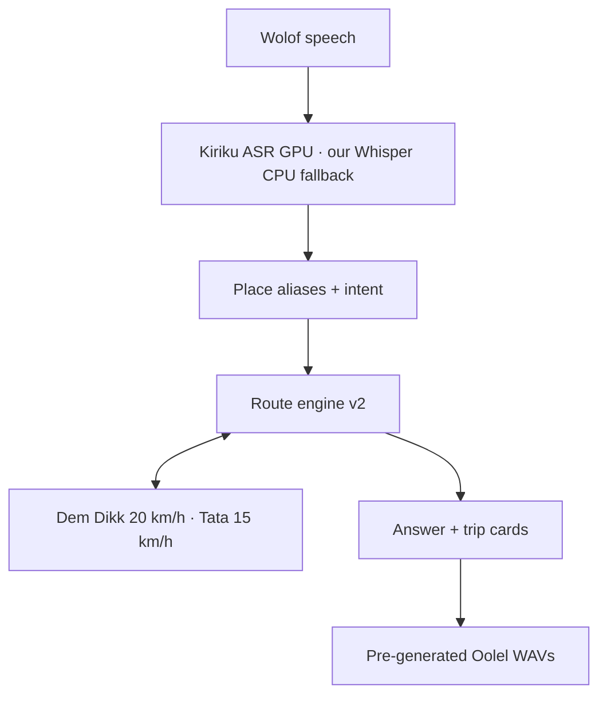

# 🚌 GuindiMa AI

### Wolof voice assistant that tells Dakar riders which bus to take

[](https://www.python.org/)
[](https://www.gradio.app/)
[](https://huggingface.co/spaces/TIJAANI/guindima-ai)
[](#-how-it-uses-the-models)
[](#-how-it-uses-the-models)
[](LICENSE)

## 📑 Table of contents

- [📋 Context & problem](#-context--problem)
- [🎯 Solution](#-solution)
- [📸 Preview](#-preview)
- [🧠 How it uses the models](#-how-it-uses-the-models)
- [🧭 Architecture](#-architecture)
- [🗣️ Wolof, by a native speaker](#-wolof-by-a-native-speaker)
- [📊 Key results](#-key-results)
- [🕰️ Built before vs during the hackathon](#-built-before-vs-during-the-hackathon)
- [⚠️ Limitations](#-limitations)
- [🚀 Run it yourself](#-run-it-yourself)
- [🔮 Next steps](#-next-steps)
- [👨‍💻 Author](#-author)
- [💚 Credits and licenses](#-credits-and-licenses)
- [📄 License](#-license)
- [🙏 Acknowledgements](#-acknowledgements)

---

## 📋 CONTEXT & PROBLEM

GuindiMa tells people in Dakar which bus to take, by voice, in Wolof. It was
built for the **GOMYCODE x NVIDIA hackathon** (27 Sept 2026), where it won
**2nd place in Senegal** and the **NVIDIA Brev Breakthrough Award**.

Many bus riders in Dakar speak Wolof and cannot read, or read little. The
information they need is spread across sources, not always written in the
language they use. Tata AFTU minibuses and Dakar Dem Dikk buses serve
overlapping routes, and a rider often has to ask people at the stop.

---

## 🎯 SOLUTION

Say, or type, in Wolof where you are and where you go. GuindiMa answers both
out loud and on screen: which line (Dakar Dem Dikk or Tata AFTU), where to
board, where to get off, the direction, possible transfers and walking. The
screen shows the same route as simple trip cards, in French. It was built so
that riders who read little can use it entirely by voice.

**Links:**

- 🌐 **Live demo:** **https://huggingface.co/spaces/TIJAANI/guindima-ai**
- 🎥 **Demo video:** <!-- TODO: add the demo video link -->
- 💻 **Code:** <!-- TODO: add the public repository link -->
- 🚏 **Dataset:** built from official AFTU route traces, Dem Dikk official
  itineraries ([demdikk.sn](https://demdikk.sn/info-voyageurs/)) and
  OpenStreetMap <!-- TODO: add a published dataset link -->

Honest note: the live Space still runs the **previous version**. The new route
engine (v2) and the native Oolel voice go live after the voice generation.

---

## 📸 PREVIEW

<!-- TODO: add two screenshots — the Wolof voice answer and the trip cards -->

---

## 🧠 HOW IT USES THE MODELS

| Part | Model | What it does |
| --- | --- | --- |
| Speech to text, GPU | `AIHubSN/Kiriku-Wolof-ASR` | Transcribes the Wolof recording; recognizes stop names far better than a generic Whisper. |
| Speech to text, CPU | `TIJAANI/whisper-small-wolof-dakar-essai3` | Our own Whisper, fine-tuned on Wolof voices we collected in Dakar (int8, CPU). Runs when the free GPU is not granted. |
| Speech to text, fallback | `M9and2M/whisper-small-wolof` | Public fallback loaded if our private fine-tuned repo is unavailable. |

The other parts are clearly non-ASR:

| Part | Model or code | Why it is used |
| --- | --- | --- |
| Route engine | Our own Python code: graph of (line, direction, stop), Dijkstra/A\*, at most two transfers, walking transfers | Finds bus legs, transfers and walking from the public line data. |
| Spoken reply | Oolel-Voices by `soynade-research` (AGPL-3.0), native voice sample `8_1_c` | Pre-generated WAV files; no TTS model runs inside the app. |
| Place extraction, last resort | `meta/llama-3.2-11b-vision-instruct` on NVIDIA Build | Only called when the local, dictionary-based extraction finds no complete trip. |
| Small talk | Rule-based, basic Wolof conversation | Greetings, thanks, "who are you". |

---

## 🧭 ARCHITECTURE



- **Speech to text:** Kiriku-Wolof-ASR on GPU at startup; our
  `whisper-small-wolof-dakar-essai3` (fine-tuned in Dakar, int8, CPU) takes over
  and also serves the second transcription chance; `M9and2M/whisper-small-wolof`
  as fallback.
- **Understanding:** place aliasing and Wolof numbers first, locally; Llama 3.2
  on NVIDIA Build only if the extraction finds no complete trip.
- **Route engine v2 (default):** the graph over (line, direction, stop) is built
  once at startup; Dijkstra/A* search; walking transfers; Dem Dikk at 20 km/h,
  Tata at 15 km/h; the fastest direct trip comes first. `GUINDIMA_MOTEUR=v1`
  brings back the old engine, on purpose.
- **Reply:** pre-generated WAVs with the native Oolel voice `8_1_c`; the
  pronunciation lexicon was written by a native Wolof speaker.

---

## 🗣️ WOLOF, BY A NATIVE SPEAKER

The Wolof answers were checked by native speakers, and the pronunciation
lexicon is written by a native Wolof speaker. The app uses reviewed sentence
templates instead of free-form spoken text, so the spoken answer stays short
and predictable.

The spoken spellings are separate from the displayed names. For example,
`TAF TAF OUAKAM (TO1)` is spoken as `TAF TAF Wakaam`, and line numbers are
spoken as Wolof words ("numero benn"), never as French digits. A word-level
pronunciation lexicon (`src/tts/lexique_prononciation.py`) lets the native
speaker fix a word once, for every answer.

When two possibilities exist, the app says both, separated by "Walla,", and
shows the same two options on screen.

---

## 📊 KEY RESULTS

From the on-disk audit of **304 trip pairs**:

- ✅ **0 absurd answer.**
- ✅ **71%** of pairs find a direct line.
- ✅ mean trip duration **54.4 min**.
- ✅ **Test suite: 530 checks** across 7 suites, using fakes only: no real model
  downloads, no real voice calls, no network access.

Per suite: `test_trajets.py` 388 · `test_collecte.py` 99 · `test_itineraires.py`
9 · `test_evaluer_modele.py` 6 · `test_finetune_whisper.py` 14 ·
`test_seconde_chance.py` 7 · `test_asr_secours.py` 7.

No personal data is stored. The transcript is sent to the NVIDIA Build API only
when local extraction cannot find the trip.

---

## 🕰️ BUILT BEFORE VS DURING THE HACKATHON

| Before the hackathon | During the hackathon |
| --- | --- |
| The route data: **65 official AFTU route traces**, **Dem Dikk official itineraries** (demdikk.sn), OpenStreetMap stops; the Wolof voice dataset and the fine-tuned Whisper built from it. | Everything else in this repository: the previous matching engine and app, then the **route engine v2**, the **native Oolel voice pipeline** (869-audio plan + pronunciation lexicon), **basic Wolof conversation**, and the 530-check test suite. |

---

## ⚠️ LIMITATIONS

- The route data is incomplete: intermediate stops are known for the Tata AFTU
  lines and 7 Dem Dikk lines; other Dem Dikk lines are found terminus to
  terminus only.
- The live demo still runs the previous engine; v2 and the native voice go live
  after the voice generation (see Solution).
- On the free Hugging Face GPU (ZeroGPU), authenticated visitors rarely get a
  slot; everyone else falls back to our CPU Whisper: answer in ~5-25 s, a bit
  less accurate, but trips are still found thanks to phonetic aliasing.
- The ASR makes mistakes: noisy street recordings, Wolof speech to text is
  imperfect, hence the fuzzy place matching.
- Wolof only: display is French, but no French or multilingual input is taken.
- **Pillow 12.3.0**: Gradio 6.30 (pinned by `sdk_version` in the Space README)
  requires `pillow<13.0`, so the version fixing the 37 known CVEs cannot be
  installed. The app uses no image component; the upgrade will follow Gradio.

---

## 🚀 RUN IT YOURSELF

GuindiMa needs Python 3.12.

```powershell
python -m venv .venv
.\.venv\Scripts\Activate.ps1
pip install -r requirements.txt
```

Copy `.env.example` to `.env` and fill in your own key. Variable names only;
no secrets are included in this repository:

- `NVIDIA_API_KEY` — the NVIDIA Build key, used only by the last-resort
  extraction.
- `HF_TOKEN` — read from the environment at launch (Space secret in
  production), to load our private fine-tuned Whisper.

Start the local app:

```powershell
python app.py
```

The engine choice: `v2` (new engine) by default — set nothing to get it;
`GUINDIMA_MOTEUR=v1` forces the old engine, on purpose. If v2 fails to start,
the app raises a clear error instead of silently falling back to v1.

Run the tests, no model loading, no network:

```powershell
python tests\test_trajets.py
python tests\test_itineraires.py
python tests\test_collecte.py
python tests\test_seconde_chance.py
python tests\test_asr_secours.py
python tests\test_evaluer_modele.py
python tests\test_finetune_whisper.py
```

The suite has **530 checks** across those 7 suites.

---

## 🔮 NEXT STEPS

- [ ] Generate the **869 native-voice WAVs**
  (`notebooks/voix_oolel_complete.ipynb` is ready) and switch the live Space to
  engine v2 + native voice.
- [ ] Publish the route data as an open dataset.
- [ ] More field corrections from riders and drivers (`data/corrections/`).
- [x] Basic Wolof conversation (greetings, thanks, who are you).

---

## 👨‍💻 AUTHOR

**Cheikh Niang** — Data Scientist, Dakar.

- 📧 <!-- TODO: add email link -->
- 💼 <!-- TODO: add LinkedIn link -->
- 🌐 <!-- TODO: add portfolio link -->

---

## 💚 CREDITS AND LICENSES

**Voice**: Oolel-Voices by soynade-research — **AGPL-3.0** —, used offline to
pre-generate the audio, from the native voice sample `8_1_c` of the Space
[soynade-research/Oolel-Voices-Demo](https://huggingface.co/spaces/soynade-research/Oolel-Voices-Demo).
Only **offline pre-generated WAV files** ship with the app: **no TTS model
runs inside the app**.

**Transcription (ASR)**:

- [`AIHubSN/Kiriku-Wolof-ASR`](https://huggingface.co/AIHubSN/Kiriku-Wolof-ASR)
  (GPU transcription online) — license: see model card (TODO verify);
- [`M9and2M/whisper-small-wolof`](https://huggingface.co/M9and2M/whisper-small-wolof)
  (CPU fallback when the GPU is not there) — license: see model card (TODO verify);
- [`TIJAANI/whisper-small-wolof-dakar-essai3`](https://huggingface.co/TIJAANI/whisper-small-wolof-dakar-essai3)
  (our fine-tuning on the Dakar collection, private repo) — license: see model
  card (TODO verify).

**Data**:

- AFTU official route maps:
  [aftu-senegal.org](https://aftu-senegal.org/infos-pratiques/);
- Dakar Dem Dikk official routes:
  [demdikk.sn](https://demdikk.sn/info-voyageurs/);
- Maps and stops: OpenStreetMap, via
  [Overpass](https://overpass-api.de/) and
  [Nominatim](https://nominatim.org/) — « © OpenStreetMap contributors, ODbL 1.0 ».

The original CSV files are never edited: corrections live in
`data/corrections/`, with their source.

---

## 📄 LICENSE

GuindiMa's code is © 2026 Cheikh Niang — all rights reserved; see
[`LICENSE`](LICENSE): consultable, but no reuse, copy or modification without
written permission. Third-party models keep their own licenses, listed in
[Credits and licenses](#-credits-and-licenses).

---

## 🙏 ACKNOWLEDGEMENTS

- **AI Hub Sénégal** — Kiriku-Wolof-ASR.
- **soynade-research** — Oolel-Voices.
- **M9and2M** — whisper-small-wolof.
- **CONCREE** — the first-generation voice, cloned from Adia_TTS (today's
  fallback cache).
- **AFTU and Dakar Dem Dikk** — public line information.
- **OpenStreetMap contributors** — ODbL 1.0.
- **GOMYCODE x NVIDIA** — the hackathon, and the NVIDIA Brev Breakthrough Award.
- **Hugging Face** — hosting for the live demo.

---

## 🌍 EN FRANÇAIS

GuindiMa est un assistant vocal pour les bus de Dakar : dites (ou écrivez) en
wolof où vous êtes et où vous allez, et l'app répond à voix haute avec la
ligne, où monter, où descendre, les correspondances et la marche à pied.
L'affichage reste en français, pensé aussi pour ceux qui ne lisent pas.
Le Space en ligne tourne encore avec la version précédente : le nouveau moteur
d'itinéraires et la voix native partent en ligne après la génération des
audios. Code consultable, tous droits réservés — voir [`LICENSE`](LICENSE).

---

<div align="center">

**GuindiMa AI · GOMYCODE x NVIDIA hackathon 2026 · 2nd place Senegal, NVIDIA Brev Breakthrough Award · Built in Dakar, for Dakar**

</div>
